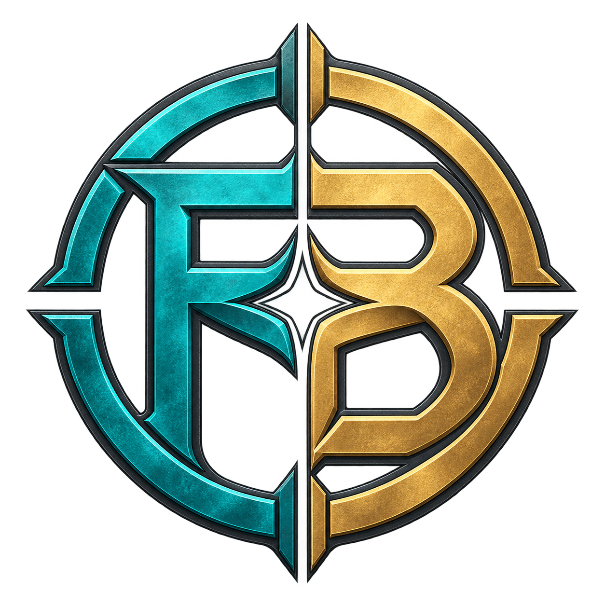

<div align="center">
  

# KOTOR II: Force Bond

**The official launcher for the unofficial co-op mod for Knights of the Old Republic II — The Sith Lords.**

[Download the launcher](../../releases/latest) · [Website](https://force-bond.pages.dev) · [Discord](https://discord.gg/9bPWjkaqBn)

</div>

## Play together

| Mode | Players | How it works |
| --- | --- | --- |
| **Story** | Up to 3 | Play the campaign together with a shared inventory. |
| **Story+** | Up to 8 | Play the campaign together with your own characters and inventories. |

## Get started

1. Install **KOTOR II on Steam** on Windows.
2. Download and extract the launcher ZIP into a folder you can write to.
3. Keep `ForceBond.exe` and `ForceBond.Updater.exe` together and start `ForceBond.exe`.
4. Follow the launcher prompts to install Force Bond and get updates.

This repository distributes the launcher. You need your own Steam copy of KOTOR II.

## Follow development

- [Website and roadmap](https://force-bond.pages.dev/#roadmap)
- [Discord community](https://discord.gg/9bPWjkaqBn)
- [YouTube devlogs](https://www.youtube.com/@Syndicate_Corp)
- [Support Syndicate Corp. on Patreon](https://www.patreon.com/cw/syndicate_corp)

*Force Bond is an independent community project by Syndicate Corp.*

## Build from source

On Windows with the .NET 10 SDK, run:

```powershell
dotnet build Launcher/ForceBond.Launcher.csproj
dotnet build Updater/ForceBond.Updater.csproj
```

The source export includes the Windows launcher and updater. The game engine and game files are distributed separately. Discord authorization and automatic updates are disabled in source builds by default. The official launcher downloads are configured for the official update service.

The launcher and updater source code is licensed under MIT. Project artwork, logos, and third-party marks are excluded from that license.
